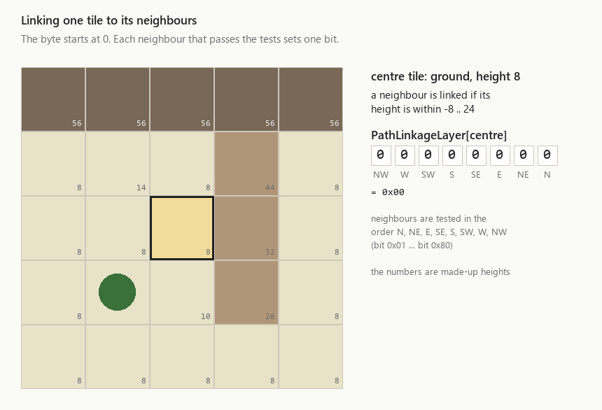
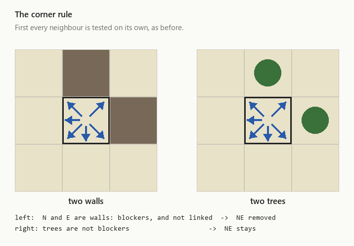
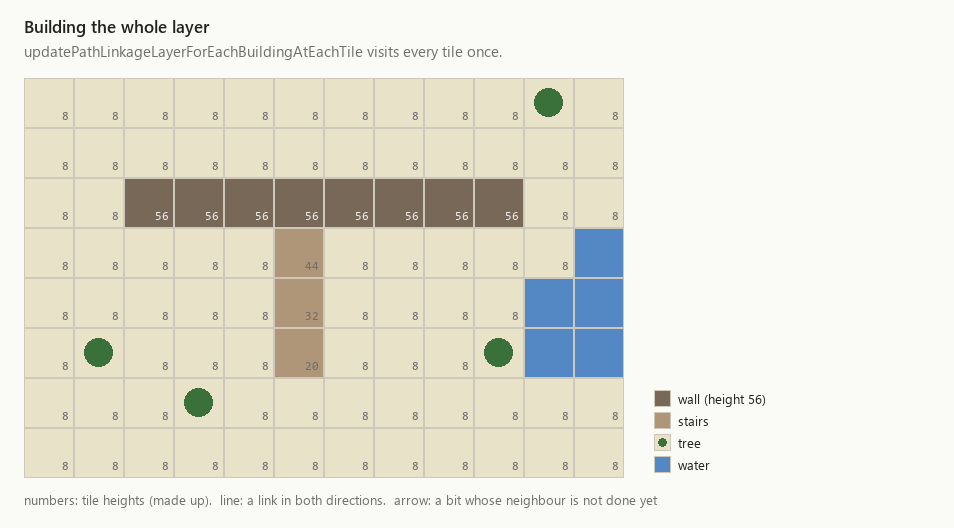
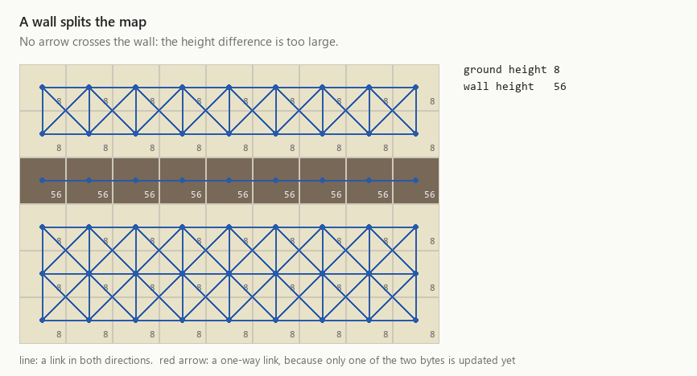

# The path linkage layer

Before a unit can plan a route, the game has to know a simpler thing: from this tile, which
neighbouring tiles can I step onto? The answer is stored in the **path linkage layer**
(`PathLinkageLayer`), an array with one byte per map tile. Each of the eight bits in a tile's byte
stands for one direction. A set bit means "a unit on this tile may step to that neighbour".

The game reads this layer constantly. It is the input to the
[area flood fill](update-separate-area-tile-map.md), and the linkage-based searches
(`findLinkageBasedPathOrWalkRadius`, `findSuitableSpawnLocationUnk`) walk it too. This page
explains how the bytes are computed.

In graph terms, the tiles are the **nodes** and the set bits are **directed edges**. Each byte
lists the edges *leaving* its tile. A tile's byte says nothing about whether its neighbours can
step back. That is decided by the neighbours' own bytes.

## The bits

| Bit | `0x01` | `0x02` | `0x04` | `0x08` | `0x10` | `0x20` | `0x40` | `0x80` |
| --- | --- | --- | --- | --- | --- | --- | --- | --- |
| Direction | N | NE | E | SE | S | SW | W | NW |

The directions go clockwise starting at north. The table that finds a tile's neighbours,
`directionTranslationMatrix[row][0..7]`, uses the same order. So does the table
`BitFlagHelperForPathLinkage`, which simply holds `1, 2, 4, … 128`. Direction number `i` is
always bit `1 << i`.

The animations below use small square grids and made-up heights. The real map is a diamond (see
[how the map is stored](update-separate-area-tile-map.md)), but every rule on this page only ever
looks at a tile and its eight direct neighbours, so the shape of the map does not matter.

## The rule for one tile

The core is `PathFindingState::updatePathLinkageLayerBasedOnBuildingsUnk` (Crusader 1.41 address
`0x004999C0`). Despite the placeholder name, it computes the complete byte for **one** tile. It
does not reimplement cleanly yet: a 51% draft lives on the `reimpl/PathFindingState-development`
branch. The description below was checked against the original's assembly.

### Step 1: what kind of tile is this?

The function reads the tile's flags from `LogicLayer`, its height from `HeightLayer`, and the
building standing on it from `BuildingLayer`. On a keep, the keep's own height is added, so the
roof counts rather than the ground underneath. It then puts the tile into one **mode**. The checks
run in the order of this table, and the first one that matches wins:

| Tile has | Mode | What happens |
| --- | --- | --- |
| `L_CLIMBABLE` (a ladder spot) | ladder | neighbours tested normally |
| `L_KEEP_NON_MANOR_HOUSE` | keep | links to the rest of the keep and to walls |
| `L_STOCKPILEUnk` or `L_FORD` | ground | walkable, even if other flags say river or building |
| `L_STAIRS` | stairs | neighbours tested normally |
| `L_CRENEL_VARIATIONUnk` | blocked | the byte stays 0, done |
| `L_WALL_OR_GATEHOUSE` | wall | if a building stands on it, it is a gatehouse wall |
| sea, river, moat, rocks, tree, building, border, hop or dairy field | blocked | the byte stays 0, done |
| anything else | ground | plain open ground |

The "blocked" row is the bit mask `0x4A5014B1`. The [area flood fill](update-separate-area-tile-map.md)
uses the same mask to choose its seed tiles.

The order matters. A ford is a river tile that units can wade through: it carries the `L_RIVER`
flag, but `L_FORD` is checked first, so the tile counts as ground.

### Step 2: test the eight neighbours

The byte starts at 0. For each neighbour, in the order N, NE, E, SE, S, SW, W, NW, the function
decides whether to set that direction's bit. Most of the time the decision is the **height rule**:

> A neighbour is linked if its height is within 16 of this tile's height.

Precisely, with `h` the tile's height, the neighbour is linked when
`h - 16 <= neighbourHeight <= h + 16`. That one rule explains a lot. Ground is linked to ground,
and the top of a wall is linked to the next wall tile. A unit cannot step from the ground straight
onto a wall, because the difference is far more than 16. **Stairs** work because each step is
less than 16 higher than the one before.



Some kinds of neighbour bypass the height rule or are never linked at all:

| Neighbour has | Outcome |
| --- | --- |
| `L_FORD` | height rule |
| `L_STAIRS` | never from a keep; never if the stairs' `DamageLayer` value is above 20; otherwise height rule |
| `L_STOCKPILEUnk` | never from a keep; never if a building stands on it; otherwise height rule |
| `L_BUILDING` | **never** linked |
| `L_KEEP_NON_MANOR_HOUSE` | linked from keep tiles; from wall tiles unless the wall's damage is above 20; never from anything else |
| `L_CRENEL_VARIATIONUnk` | never |
| `L_WALL_OR_GATEHOUSE` | from a keep or a gatehouse wall: linked unless the neighbour's damage is above 20, **no height rule**; from a wall or stairs into a gatehouse wall: linked unless this tile's damage is above 20; otherwise height rule |
| map border (`L_BORDER`, `L_BORDER_EDGE`) | never |
| any other impassable flag (sea, river, rocks, tree, moat, …) | never |
| anything else | height rule |

The `DamageLayer` is a per-tile byte that the game uses for several things; on farm fields, for
example, it holds the growth stage. On walls it holds the wall's damage. So a badly damaged wall
or staircase loses its special connections.

### Step 3: no squeezing through corners

Tested one by one, a diagonal step can be allowed even when both tiles beside it are blocked: a
unit would slip between two walls that touch only at a corner. A second pass removes such
diagonals. For a **ground** tile the rule is:

> Remove the NE link if N and E are both *blockers* and neither of them is linked.

The same applies to NW (with N and W), SE (S and E) and SW (S and W).



The surprise is what counts as a blocker. While testing the neighbours, the function marks only
these as blockers:

- walls and gatehouses,
- keeps,
- `L_CRENEL_VARIATIONUnk` tiles,
- the map border,
- buildings whose type is listed in a per-type table in the game's data: keeps, gatehouses,
  towers, keep doors, barracks, mercenary post, armoury, mill, chapel, manor house, water pot,
  European outpost, and one unidentified type (79).

Trees, rocks, water and all other buildings are **not** blockers. Units may therefore step
diagonally between two trees, or between two houses.

Tiles on a wall, stairs, keep or ladder use a different corner test. It removes the NE link if N
and E are both wall or keep, NE is neither of those nor a stockpile, and neither N nor E is
stairs. It appears to stop a unit on a wall from stepping diagonally off a wall corner.

### Step 4: store the byte

The byte is written to `PathLinkageLayer[tile]`. The function returns `TRUE` if a gatehouse or a
keep stands on the tile, and `FALSE` otherwise. The callers below use that return value.

## Building the whole layer

`PathFindingState::updatePathLinkageLayerForEachBuildingAtEachTile` (`0x004A5F60`) applies the
rule to every tile of the map, one after another. When a map is set up, the game runs it first,
then builds the areas, and then calls `BuildingsState::updatePathLinkageLayerForAllBuildings`. That
function hands every building to `TileMapState::updatePathLinkagesForBuilding`, which is not
reimplemented yet and is not covered here.



In the finished picture every link happens to be two-way, so each is drawn as a plain line. On a
real map the links form one big graph: the area flood fill finds its connected pieces, and the
path searches find routes through it.

## Keeping it up to date

Rebuilding all 80,400 bytes whenever something changes would be wasteful. Look at what the rule
reads, though: one tile's byte depends only on that tile and its eight neighbours. So when a tile
changes, only nine bytes can be affected, namely its own and those of its eight neighbours. Every
other tile neither *is* the changed tile nor *has* it as a neighbour.

That is exactly what `PathFindingState::updatePathLinkagesInAllEightDirections` (`0x004A5F90`)
does. It recomputes the changed tile, then its eight neighbours. When a wall is destroyed,
`destroyWall` calls it for each affected tile.



Halfway through the update some bytes are new and some still old. Briefly, links can then be
one-way, the red arrows in the animation. Once all nine bytes are recomputed, the gap is linked in
both directions.

If any of the nine tiles holds a gatehouse or a keep (the `TRUE` return value from step 4), the
function sets `BuildingsState::pathLinkageKeepWasUpdatedUnk`. Recomputing those tiles has just
overwritten the special links described in the next section. On the next game tick,
`BuildingsState::updatePathLinkageForGatesKeepsSiegeTowers` sees the flag and puts them back for
every gatehouse, keep and siege tower on the map.

## Special links: gates, keeps and siege towers

The rule above knows nothing about gates opening and closing, keep entrances or siege towers. For
these, small functions **patch individual bits** after the rule has run.

- **Gatehouses**, `updatePathLinkageTileMapRelatedToGates` (`0x00499FA0`). A gatehouse has two
  openings on opposite sides: west and east for building variation 80, north and south otherwise.
  At each opening the function looks at the tile just outside and the tile just inside, and sets
  or clears the two bits that point at each other. It clears them if the gate is closed
  (`pathLinkageRelated2 == 2`), if the outside tile is impassable, or if their heights differ by
  more than 16. Otherwise it sets them. Opening or closing a gate calls this function. So does the
  [area flood fill](update-separate-area-tile-map.md), which closes every gate while it runs.
- **Keeps**, `updatePathLinkageTileMapRelatedToKeeps` (`0x0049A1C0`). This sets the pair of bits
  between the keep's entrance and the tile in front of it. Which pair depends on the keep's
  orientation. It only ever sets bits.
- **Siege towers**, `updatePathLinkageTileMapRelatedToSiegeTower` (`0x0049A2E0`). This sets a
  fixed cross-shaped pattern of north–south and east–west links across the tower's footprint.
- **Making a tile two-way**, `updatePathLinkageLayerAtTileForSomeLogicalReason` (`0x00499DC0`).
  For each neighbour that is not border or impassable, this copies the tile's own bits onto the
  neighbour's opposite bit. Afterwards every link of that tile works in both directions. We have
  not traced its callers yet.

## Links are one-way

Because every tile computes its own byte, nothing forces A→B and B→A to agree. The height rule is
symmetric (if A is within 16 of B, then B is within 16 of A), so on plain terrain the links come in
pairs. Several of the special cases are not symmetric, though. Take a staircase whose damage is
above 20. A ground tile next to it does not link to it, but the stair tile itself still uses the
height rule and can link back to the ground.

Every reader of the layer follows only the bits of the tile it is standing on. The flood fill,
for example, enters a neighbour only if the *current* tile has the bit for it. Keep this in mind
when you read the path-finding code.

## The whole rule as pseudocode

```c
BOOL updateLinkageForTile(int y, int tile)
{
    uint logic  = LogicLayer[tile];
    int  height = HeightLayer[tile];
    if (logic & L_KEEP) height += buildingHeight(BuildingLayer[tile]);
    BOOL result = tile has a gatehouse or keep building;

    PathLinkageLayer[tile] = 0;
    mode = classify(logic);                      // step 1, first match wins
    if (mode == BLOCKED) return result;

    byte links = 0, blockers = 0;
    for (int i = 0; i < 8; i++) {                // N, NE, E, SE, S, SW, W, NW
        int n = tile + directionTranslationMatrix[y][i];
        switch (neighbourOutcome(mode, n)) {     // the neighbour table, step 2
        case NEVER:                  break;
        case NEVER_BUT_BLOCKS:       blockers |= 1 << i; break;
        case LINK:                   links |= 1 << i; break;   // keep and gatehouse cases,
                                                               // damage permitting
        case HEIGHT_RULE_AND_BLOCKS: blockers |= 1 << i; /* fall through */
        case HEIGHT_RULE:
            if (abs(HeightLayer[n] - height) <= 16) links |= 1 << i;
            break;
        }
    }
    links = removeCornerSqueezes(mode, links, blockers);   // step 3
    PathLinkageLayer[tile] = links;              // step 4
    return result;
}
```
