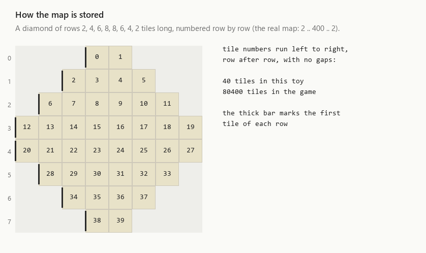
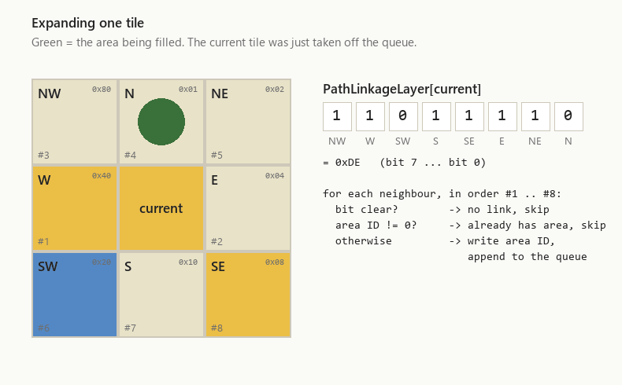
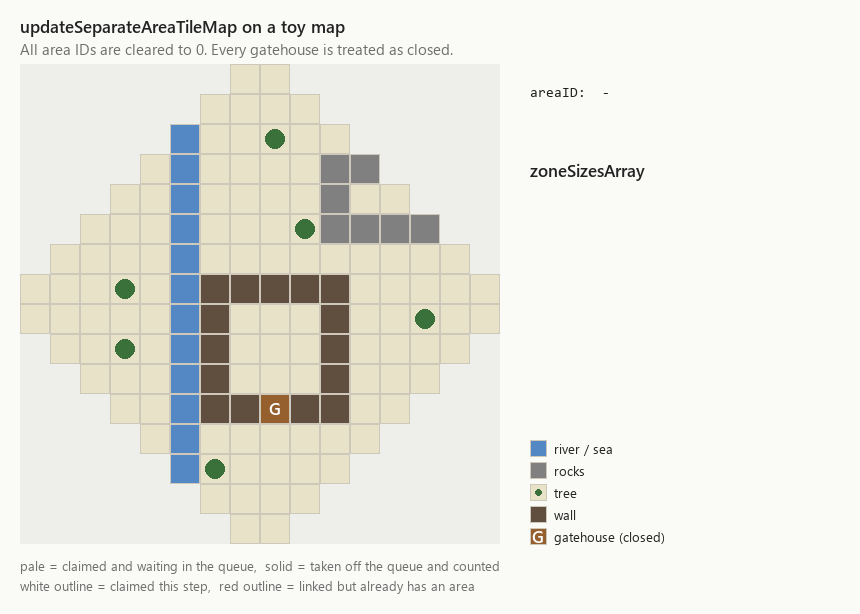

# Separate areas: the area flood fill

Units constantly need to know whether they can reach a place at all. Running a full path search
to find out is expensive, so the game precomputes the answer. It splits the map into **areas**:
groups of tiles where a unit standing on any tile can walk to any other tile of the group. It then
writes the area's number onto every tile. "Can I walk from A to B?" becomes "do A and B have the
same area number?", which is a single comparison.

The function that builds these areas is `PathFindingState::updateSeparateAreaTileMap`
(Crusader 1.41 address `0x004995E0`). Our reimplementation is in
`src/OpenSHC/Map/Navigation/PathFindingState/updateSeparateAreaTileMap.cpp`.

In computer-science terms, it finds the **connected components** of a graph. The tiles are the
nodes, and an edge joins two neighbouring tiles when a unit can step from one to the other. It
does this with a **breadth-first flood fill**, the same idea as the paint-bucket tool in an image
editor.

## The data involved

The game keeps several *layers*: arrays with one entry per map tile. This function uses these:

| Name | Type per tile | Meaning |
| --- | --- | --- |
| `PathLinkageLayer` | 8-bit byte | Which of the eight neighbours a unit may step to from this tile. One bit per direction. |
| `PathConnectionLayer` | 16-bit number | **The output**: the area ID of the tile, or 0 if it belongs to no area. |
| `LogicLayer` | bit flags | What is on the tile: sea, river, rocks, tree, building, moat, and so on. |

It also fills these fields of `PathFindingState`:

| Name | Meaning |
| --- | --- |
| `zoneSizesArray[1000]` | Number of tiles in each area, indexed by area ID. |
| `totalZones` | One more than the highest area ID handed out. |
| `sum` | Total number of tiles in all areas. |

The bits of a `PathLinkageLayer` byte are:

| Bit | `0x01` | `0x02` | `0x04` | `0x08` | `0x10` | `0x20` | `0x40` | `0x80` |
| --- | --- | --- | --- | --- | --- | --- | --- | --- |
| Direction | N | NE | E | SE | S | SW | W | NW |

Other code builds the linkage layer from the terrain, walls and buildings; see
[the path linkage layer](path-linkage-layer.md). This function only reads it. That separation is what keeps the flood fill simple: it never has to ask *why* a step is
forbidden, it just tests a bit.

## How the map is stored

A Stronghold Crusader map is a **diamond**, not a square. The game stores it as 400 rows, with
lengths 2, 4, 6, … 400, 400, … 6, 4, 2. Those are 80,400 tiles in total (`MC_MAP_TILES_COUNT`).
The tiles are numbered row by row with no gaps, so a single integer, the *tile index*, identifies
a tile. Every layer is a flat array indexed by that number.



The animation uses a small diamond, 2 to 8 tiles wide, but the real map follows the same rules.

- **Left and right** neighbours are always `tile - 1` and `tile + 1`.
- **Up and down** are harder, because the rows have different lengths. The tile directly above
  tile 30 is 7 numbers back, but above tile 7 it is only 5. The game precomputes these offsets
  per row in `directionTranslationMatrix[row]`: entry `[row][0]` is the step to the tile above,
  and entry `[row][4]` the step to the tile below. Once you have the tile above, its left and
  right neighbours (NW and NE) are again −1 and +1. The same goes for the row below.

So to find the neighbours, the function needs each tile's row number as well as its index.
That is why the queue described below stores a row next to every tile.

## When it runs

`processGameTick` calls the function once every game tick with `forceUpdate = FALSE`. Most calls
return straight away, because two conditions limit how often the work is done:

1. **A countdown.** `counterForUpdatingSeparateAreaTileMaps` goes down by one on every call. While
   it is still above zero, the function returns `FALSE` immediately. When it reaches zero, it is
   reset to 200. So the function looks at the map at most once every 200 ticks.
2. **A "dirty" flag.** Even then, it only does the work if `toggleUpdateSeparateAreaTileMap` is
   set. Code that changes the map sets this flag, for example loading a map or editing terrain in
   the map editor. The function clears it when it runs.

Calling it with `forceUpdate = TRUE` sets the flag and resets the countdown, so the areas are
rebuilt on that same call. The game does this when it sets up a map, for example at startup or
when the editor creates a new map, so that valid areas exist from the very first tick.

The function returns `TRUE` when it rebuilt the areas and `FALSE` when it did not.

## The algorithm, step by step

### 1. Prepare

- Clear `PathConnectionLayer` and `zoneSizesArray` to zero. Every tile now has "no area".
- Call `BuildingsState::updatePathLinkageTileMap(1)`. This **closes every gatehouse**, but only
  for this calculation. It remembers each gate's real state, marks the gate as shut and updates
  the linkage layer around it to match. The real states are restored at the end of the function.

Because the gates are treated as closed, the inside of a castle whose only exits are gatehouses
becomes an area of its own. This makes sense because whether a unit may pass a gate depends on
who owns the gate and the unit, which a single area number per tile cannot express. Crossing
between areas is answered separately; see *Who uses the result* below.

### 2. Scan for a seed

The function walks over all tiles in index order, 0 to 80,399, keeping track of the current row as
it goes (see the layout animation above). It looks for a **seed**: a tile that

- has no area yet, and
- is plain open ground. Its `LogicLayer` must not mark it as sea, river, moat, border, rocks,
  tree, building, the hop or dairy farm field types, or a crenel.

Tiles that fail either test are skipped.

### 3. Flood fill from the seed

The seed gets the next area ID (the first area is 1) and goes into a queue. Then, until the queue
is empty:

1. Take the next tile off the front of the queue.
2. Add one to `zoneSizesArray[areaID]`, which counts the tiles of this area.
3. Look at its eight neighbours, always in the same order: W, E, NW, N, NE, SW, S, SE. For each
   one:
   - if the linkage bit for that direction is **0**, a unit cannot step there, so skip it;
   - if the neighbour **already has an area ID**, skip it;
   - otherwise **write the area ID into the neighbour** and add it to the back of the queue.



When the queue runs dry, every tile reachable from the seed carries the area ID. The area is
complete. The area ID goes up by one, and the scan from step 2 continues where it stopped.

Here is the whole process on a toy map. A river cuts off the west bank, a ring of rocks traps a
two-tile pocket, and a castle wall with a (closed) gatehouse encloses a courtyard. The result is
four areas.



Notice what the animation shows:

- **The area spreads in rings.** Tiles near the seed are taken off the queue first and far tiles
  last. That is what a first-in-first-out queue gives you: breadth-first order.
- **A tile is claimed when it enters the queue, not when it leaves it.** Pale tiles are claimed and
  waiting; solid ones have been processed. Claiming early means the second test above rejects any
  tile that is already waiting, so no tile is ever queued twice. The queue can therefore never
  hold more than the 80,400 tiles of the map, and the whole update does a fixed amount of work
  per tile: it takes time proportional to the number of tiles.
- **Most of the scan is skipping.** Once area 1 is filled, the scan passes over its tiles one by
  one and ignores them. Only the river bank, the rock pocket and the courtyard provide new seeds.

### 4. Finish

- The loop also stops early if the area ID reaches 1000, because `zoneSizesArray` has room for
  only 1000 entries. Tiles that were not reached by then keep area 0.
- `totalZones` is set to the next unused area ID. In the toy map that is 5 for four areas.
- `sum` is set to the total of `zoneSizesArray[1]` to `[999]`, the number of tiles in all areas.
- `updatePathLinkageTileMap(0)` restores the real state of every gatehouse.

## The whole thing as pseudocode

```c
BOOL updateSeparateAreaTileMap(BOOL forceUpdate)
{
    if (forceUpdate) { dirty = TRUE; countdown = 0; }
    countdown -= 1;
    if (countdown > 0) return FALSE;
    countdown = 200;
    if (!dirty) return FALSE;
    dirty = FALSE;

    clear(areaOf);                      // PathConnectionLayer
    clear(zoneSize);                    // zoneSizesArray
    closeAllGatehouses();               // updatePathLinkageTileMap(1)

    int areaID = 1;
    int row = 0;
    for (int seed = 0; seed < 80400; seed++) {
        if (seed >= firstTileOfRow[row + 1]) row++;
        if ((areaOf[seed] & 0xFF) != 0 || isBlocked(seed)) continue;   // see "Quirks"

        int read = 0, write = 0;
        queue[write++] = (seed, row);
        areaOf[seed] = areaID;
        while (read != write) {
            (tile, y) = queue[read++];
            zoneSize[areaID]++;
            for (dir in W, E, NW, N, NE, SW, S, SE) {
                int n = neighbour(tile, y, dir);       // uses directionTranslationMatrix[y]
                if ((linkage[tile] & bit(dir)) && areaOf[n] == 0) {
                    areaOf[n] = areaID;
                    queue[write++] = (n, rowOf(dir, y));
                }
            }
        }
        areaID++;
        if (areaID >= 1000) break;
    }

    totalZones = areaID;
    sum = zoneSize[1] + ... + zoneSize[999];
    restoreGatehouses();                // updatePathLinkageTileMap(0)
    return TRUE;
}
```

## Who uses the result

Many functions read `PathConnectionLayer` before they do anything expensive. For example,
`canNavigateFromKeepToKeep` looks up the areas of two keeps:

- if either one is 0, there is no way in or out, so the answer is no;
- if they are equal, the answer is yes, with no path search needed;
- only when they differ does it ask a slower routine. That routine considers the ways to cross
  between areas that the fill ignored, such as gates and climbable walls.

Building, AI and unit code use it the same way, as a cheap first filter.

## Quirks of the original

OpenSHC reproduces the original behaviour exactly, including the parts that look odd.

- **Handwritten assembly.** The original game's neighbour expansion in step 3 was written in
  assembly by hand, not produced by the compiler. The reimplementation therefore keeps it as inline
  assembly, using the macros in `LinkageNeighbourAsm.hpp`. The pseudocode above is what that
  assembly does. Two of the variables also come from the assembly:
  - the end of the queue (`write` above) is stored in the `forceUpdate` parameter, which is no
    longer needed by then;
  - `field_0x74` counts how often the areas were rebuilt.
- **The seed test reads only half of the area ID.** Area IDs are 16-bit numbers, but the scan in
  step 2 compares only the low 8 bits with zero. Area IDs 256, 512 and 768 therefore look like
  "no area" to the scan, while the neighbour test in step 3 still sees them correctly. On a map
  with more than 255 areas, the scan later reaches the open tiles of area 256 and treats each of
  them as a new seed. Every such seed becomes an area of exactly one tile, because all its
  neighbours already have an ID. This uses up area IDs quickly, and those tiles are counted twice
  in `sum`. Real maps rarely have that many separate areas.
- **The seed filter and the fill disagree slightly.** The `LogicLayer` test applies only to seeds.
  The fill itself trusts the linkage bits alone, so a tile that may not start an area can still
  join one when a linked neighbour reaches it.
